# LARIS tutorial: spatial ligand–receptor analysis (Slide-tags human tonsil)

The core LARIS pipeline on the Slide-tags human tonsil dataset: compute
spatially diffused ligand–receptor scores, identify spatially specific
interactions per sender–receiver cell-type pair, test them against
expression-matched gene pairs, and visualize them. All outputs shown
were produced by exactly this code with LARIS v0.15.0 defaults.

**Data**: the annotated tonsil object (`adata_tonsil.h5ad`, 5,695 cells ×
25,583 genes, with `obsm['X_spatial']` and `obs['cell_type']`) is
available from Zenodo record
[10.5281/zenodo.19981287](https://doi.org/10.5281/zenodo.19981287).

LARIS lives in the [PIASO](https://github.com/genecell/PIASO) ecosystem.
PIASO is **not** required — every step below runs with LARIS alone — but
if it is installed, its figure style gives the plots a consistent look:

```python
import scanpy as sc
import laris as la

try:                                   # optional: PIASO figure styling
    import piaso
    piaso.settings.set_figure_params()
except ImportError:
    sc.set_figure_params(dpi=96, dpi_save=150, frameon=False)
```

## 1. Load the data and the LR database

```python
adata = sc.read_h5ad("data/adata_tonsil.h5ad")
lr_df = la.datasets.lrDatabase(species="human")
```

```text
5,695 cells x 25,583 genes; 2,951 database LR pairs
```

The tonsil object carries cell-type and region annotations; both are
used below.

```python
sc.pl.embedding(adata, basis="X_umap", color="cell_type", frameon=False)
sc.pl.embedding(adata, basis="X_umap", color="region_name", frameon=False)
```

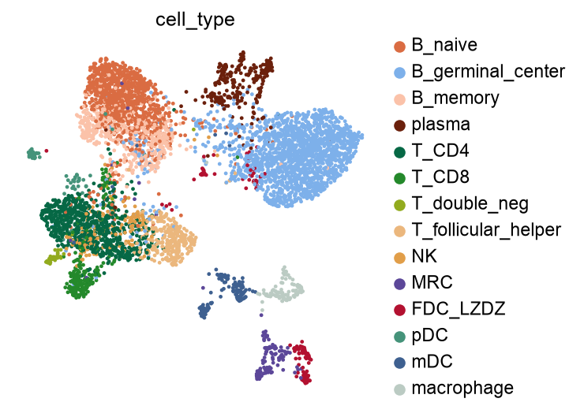
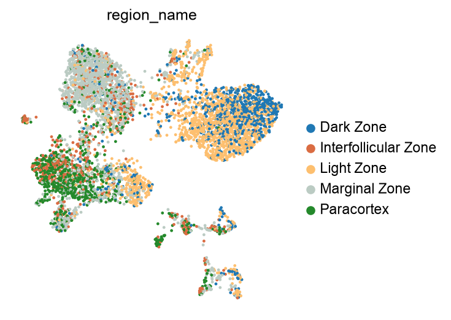

The database is a table of ligand-receptor pairs with pathway
annotation; LARIS only needs `ligand` and `receptor`, and the rest is
carried through for your own filtering.

```python
lr_df[["interaction_name", "ligand", "receptor", "pathway_name"]].head()
```

```text
      interaction_name ligand receptor pathway_name
0  TGFB1_TGFBR1_TGFBR2  TGFB1   TGFBR2         TGFb
1  TGFB1_TGFBR1_TGFBR2  TGFB1   TGFBR1         TGFb
2  TGFB2_TGFBR1_TGFBR2  TGFB2   TGFBR2         TGFb
3  TGFB2_TGFBR1_TGFBR2  TGFB2   TGFBR1         TGFb
4  TGFB3_TGFBR1_TGFBR2  TGFB3   TGFBR2         TGFb
```

```text
2,951 database pairs; 1,985 have both genes measured here
```

## 2. Spatially diffused LR scores

`prepareLRInteraction` diffuses ligand and receptor expression over the
spatial k-NN graph (adaptive kernel bandwidth by default, so coordinate
units do not matter) and multiplies the diffused pair. Only the
ligand/receptor genes are ever diffused, so this is fast and light.

```python
lr_data = la.tl.prepareLRInteraction(adata, lr_df,
                                     use_rep_spatial="X_spatial")
```

```text
lr_data: 5,695 cells x 1,985 LR pairs
```

Unmatched database pairs (genes absent from `var_names`) are dropped
with a warning; pass `unmatched='error'` when using a custom database,
where a missing name is more likely a typo.

## 3. Run LARIS

`runLARIS` scores every (sender, receiver, ligand::receptor) combination,
and with a **matched-gene background** it also tests each one: is this
interaction more specific and co-localized than expression-matched gene
pairs in the same sender-receiver context? The background is built once
(about 20 seconds here) and reused by every later run on this object:

```python
bg = la.tl.prepareLRBackground(adata, lr_df, use_rep_spatial="X_spatial")

laris_lr, res = la.tl.runLARIS(
    lr_data, adata,
    use_rep="X_spatial", use_rep_spatial="X_spatial",
    groupby="cell_type", background=bg, sort_by="p_value")
```

```text
Input data: 5695 cells × 1985 LR pairs
  ✓ Identified 1985 top spatially-specific LR pairs
  - Scaling factor: 0.249577 (based on top 100 scores)
  - Tested: interactions whose null has at least 400 non-zero pseudo-pairs; Benjamini-Hochberg within each sender-receiver pair
  - Interactions tested: 57,096
  - FDR < 0.01: 10 (0.00%)
  - FDR < 0.05: 54 (0.01%)
  - FDR < 0.10: 129 (0.03%)
Final results: 389,060 sender-receiver-LR combinations
```

The defaults (`mu=0.25`, adaptive `sigma`, all three neighbourhood sizes
at 20, `spatial_weight=3.0`) reproduce the published tonsil reference
values. The spatial specificity is computed in closed form and the
p-values are exact tail counts, so the whole run is deterministic - no
seed affects it.

With `sort_by="p_value"` the results are ordered by p-value, ties by
score, so the head of the table is the strongest evidence (the default,
`sort_by="interaction_score"`, ranks by score):

```python
res.head(8)[["sender", "receiver", "interaction_name", "interaction_score",
             "p_value", "p_value_fdr", "ligand_rank", "receptor_rank"]]
```

```text
    sender            receiver interaction_name  interaction_score  p_value  p_value_fdr  ligand_rank  receptor_rank
       MRC               T_CD4      CCL21::CCR7           0.138081 0.000025     0.004162     0.005000       0.004975
       MRC               T_CD4      CCL19::CCR7           0.099058 0.000025     0.004162     0.004975       0.004975
   B_naive            FDC_LZDZ       FCER2::CR2           0.072694 0.000025     0.004950     0.004975       0.009950
  FDC_LZDZ            FDC_LZDZ      NRG1::ITGB4           0.054539 0.000025     0.011050     0.070000       0.004975
  FDC_LZDZ            FDC_LZDZ     LAMA3::ITGB4           0.027441 0.000025     0.011050     0.095000       0.004975
macrophage T_follicular_helper  PDCD1LG2::PDCD1           0.023128 0.000025     0.009825     0.009950       0.004975
  FDC_LZDZ              plasma      WNT5A::FZD6           0.012432 0.000025     0.014575     0.004975       0.004975
  B_memory                 mDC   SEMA7A::PLXNC1           0.137342 0.000025     0.005025     0.004975       0.004975
```

CCL21 and CCL19 from marginal reticular cells (MRC) to CCR7-expressing
CD4 T cells is the chemokine axis that positions T cells in the T zone;
FCER2 (CD23) from naive B cells to CR2 (CD21) on follicular dendritic
cells, and PD-L2 (`PDCD1LG2`) from macrophages to PD-1 on follicular
helper T cells, are germinal-centre biology. Each beats all 40,000 of its
expression-matched pseudo-pairs (the p-value floor, 1/40,001).

A **call** is a row with `p_value_fdr < 0.05`: its score exceeds that of
expression-matched gene pairs in the same sender-receiver context, at an
FDR of 5% within that context. 54 interactions pass, and 129 pass the
second tier, `p_value_fdr < 0.10`. Pairs of the two cell types' marker
genes are part of the null, so a call certifies specificity *beyond*
cell-type identity; the pairing itself comes from the database.

`ligand_rank` and `receptor_rank` say which partner carries a call: the
observed pair's rank among the ligand's matched genes paired with the
observed receptor, and the other way round (1/201 = beats every peer).
`NRG1::ITGB4` within follicular dendritic cells ranks 0.005 on the
receptor side and 0.07 on the ligand side: ITGB4 makes it specific.

The top *scores* are a different list:

```python
res.nlargest(5, "interaction_score")[
    ["sender", "receiver", "interaction_name", "interaction_score",
     "p_value_fdr", "ligand_rank", "receptor_rank"]]
```

```text
      sender receiver interaction_name  interaction_score  p_value_fdr  ligand_rank  receptor_rank
     B_naive  B_naive       FCER2::CR2             0.5625       0.0564       0.0050         0.1891
T_double_neg       NK    CLEC2D::KLRB1             0.4287       0.1004       0.0448         0.0050
         pDC  B_naive        APP::CD74             0.3656       0.4742       0.0100         0.5532
      plasma   plasma     PECAM1::CD38             0.3323       0.6807       0.1244         0.0199
    B_memory B_memory     COL4A3::CD44             0.3201       0.0918       0.0100         0.1443
```

Score and significance are related but not the same thing. The
top-scoring interaction, `FCER2::CR2` among naive B cells, sits just
outside the calls (FDR 0.056): its ligand beats every peer, but its
receptor rank of 0.19 shows that CR2's expression-matched peers, paired
with FCER2, score almost as well within naive B cells. A high score says
the interaction is strong here; the p-value says it is stronger than
expression-matched gene pairs in the same context. Sort by whichever
question you are asking. [Tutorial 07](07_significance_and_background.md)
covers what the p-value tests and how to read it.

## 4. Visualize

### Interaction scores on the tissue

```python
la.pl.plotCCCSpatial(lr_data, "X_spatial", "CCL19::CCR7",
                     color_by="score")
```

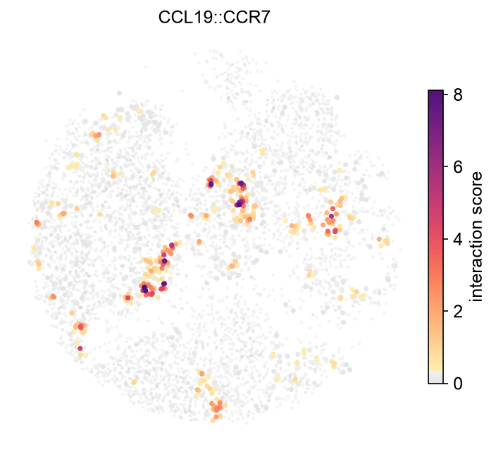

CCL19::CCR7 lights up the T-zone niches. When the object carries a
tissue image (the scanpy `uns['spatial']` convention, or a cytome image
store), it is drawn underneath automatically; `img=` and `scale_factor=`
accept an explicit registered image (e.g. Stereo-seq ssDNA).

### Dot plot across sender–receiver pairs

The summary plots show the **calls** by default: rows with
`p_value_fdr < 0.05` and a score above 0.01. Every one of them takes
`threshold=`, and below each is drawn twice, at the calls (`0.05`) and at
the second tier (`0.10`), side by side. Here, the four sender-receiver
pairs with the most second-tier rows and their top three each;
`senders` and `receivers` are paired element-wise:

```python
tier2 = res[(res.p_value_fdr < 0.10) & (res.interaction_score > 0.01)]
pairs = tier2.groupby(["sender", "receiver"]).size().nlargest(4).index
senders = [s for s, r in pairs]
receivers = [r for s, r in pairs]
interactions = (tier2.set_index(["sender", "receiver"]).loc[list(pairs)]
                .groupby(level=[0, 1]).head(3).interaction_name.unique().tolist())

for threshold in (0.05, 0.10):
    la.pl.plotCCCDotPlot(res, senders=senders, receivers=receivers,
                         interactions_to_plot=interactions,
                         threshold=threshold, score_max=0.3)
```

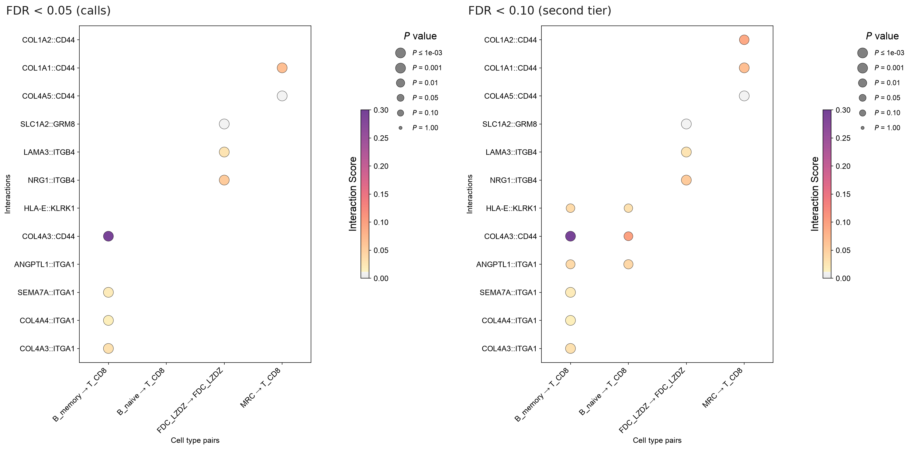

Colour is the score, on one scale for both panels (`score_max=`; by
default each plot scales to its own largest score), and size the
p-value. Memory B cells to CD8 T cells is the pair with the most calls -
collagen IV (`COL4A3`, `COL4A4`) and SEMA7A through the integrin α1
(`ITGA1`) and CD44. The second tier adds 6 dots to the 9 calls,
including a whole column: naive B cells to CD8 T cells, which has no
call at FDR < 0.05.

### Expressing cells by cell type, on the tissue

The same function's default mode highlights the cells expressing an
interaction, coloured by cell type:

```python
la.pl.plotCCCSpatial(lr_data, "X_spatial", "CCL19::CCR7",
                     cell_type="cell_type", highlight_all_expressing=True)
```

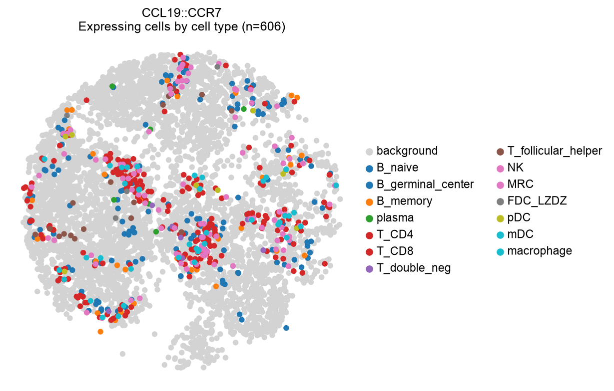

### Heatmap of the calls

```python
for threshold in (0.05, 0.10):
    la.pl.plotCCCHeatmap(res, n_top=200, threshold=threshold)
```

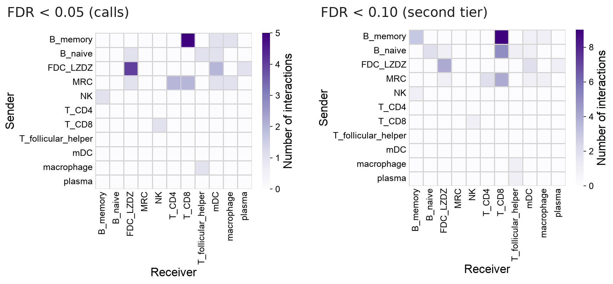

With the default filters on, the heatmap counts the calls per
sender-receiver pair: 27 rows with a score above 0.01, in 17 pairs, at
FDR < 0.05; 44 in 21 pairs at FDR < 0.10. `n_top` applies only when both
filters are off ([§6](#6-filtering-the-summary-views)).

### Faceted dot plot

One panel per sender-receiver combination, each with its own top
interactions (calls on top, the second tier below):

```python
for threshold in (0.05, 0.10):
    la.pl.plotCCCDotPlotFacet(res, senders=["MRC", "FDC_LZDZ", "B_memory"],
                              receivers=["T_CD8", "FDC_LZDZ", "mDC"],
                              n_top=8, threshold=threshold)
```

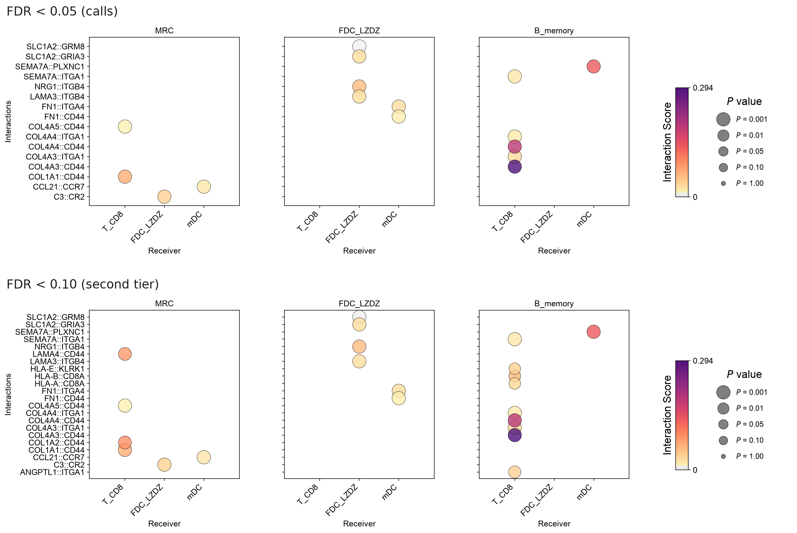

### Ligand, receptor and interaction in one dot plot

`prepareDotPlotAdata` concatenates the LR scores with the expression
object so ligand expression, receptor expression and the interaction
score appear side by side per cell type:

```python
adata_dot = la.pl.prepareDotPlotAdata(lr_data, adata)
la.pl.plotLRDotPlot(adata_dot,
                    interactions_to_plot=interactions[:6],
                    groupby="cell_type")
```

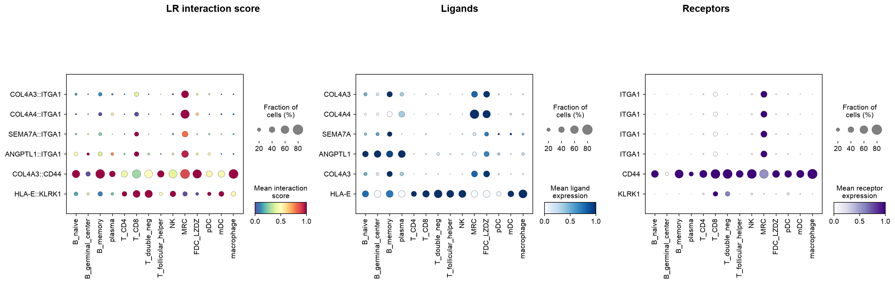

### Signalling network around one cell type

`plotCCCNetwork` draws one cell type's neighbourhood, in the direction
you ask for. Filtering on the FDR keeps the picture to interactions that
survived testing. Memory B cells show what the second tier adds:

```python
for threshold in (0.05, 0.10):
    la.pl.plotCCCNetwork(
        res, "B_memory", data=adata, groupby="cell_type",
        interaction_direction="sending",
        edge_width_scale=11,
        filter_significant=True, p_value_col="p_value_fdr", threshold=threshold,
        filter_by_interaction_score=True, threshold_interaction_score=0.001,
        figsize=(9, 8))
```

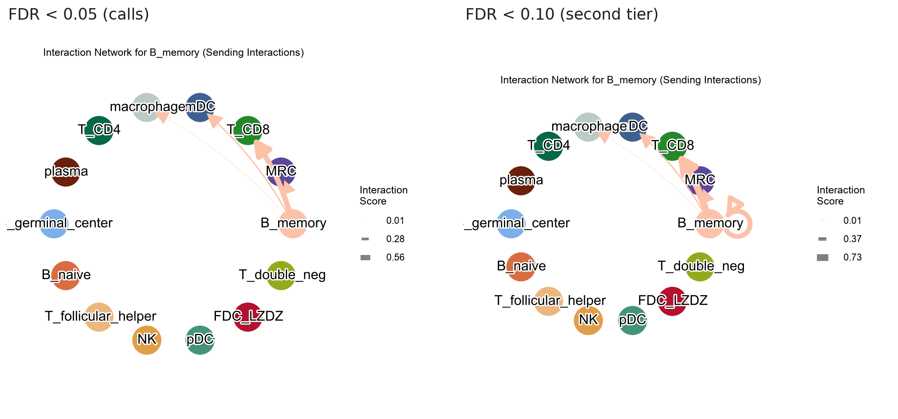

```python
for threshold in (0.05, 0.10):
    la.pl.plotCCCNetwork(
        res, "B_memory", data=adata, groupby="cell_type",
        interaction_direction="receiving",          # the other direction
        edge_width_scale=11,
        filter_significant=True, p_value_col="p_value_fdr", threshold=threshold,
        filter_by_interaction_score=True, threshold_interaction_score=0.001,
        figsize=(9, 8))
```

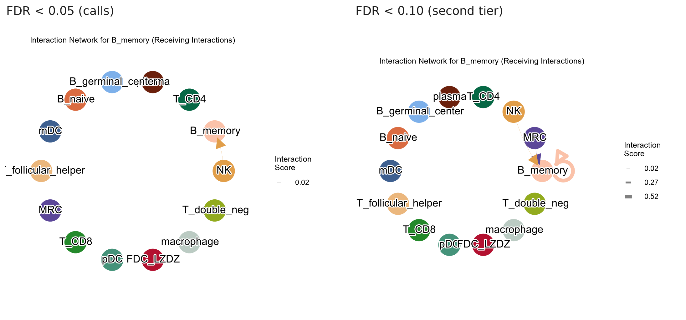

At FDR < 0.05, memory B cells send 11 calls along four edges (to CD8 T
cells, dendritic cells, macrophages and MRC) and receive one (BAFF to
TACI, from NK cells). The second tier adds memory B cells signalling to
themselves (`SEMA7A::PLXNC1`, `COL4A3::CD44`) and, in the receiving
direction, MRC: 21 rows along five edges sending, 7 along three
receiving.

**`edge_width_scale` almost always needs tuning.** Edge width is the
summed interaction score times this factor, and the sum depends on how
many interactions a cell-type pair has and how strong they are - so a
value that suits one dataset will be too thick or too thin on the next.
Here the heaviest edge, memory B to CD8 T cells, sums to about 0.56 at
FDR < 0.05 (0.73 at FDR < 0.10), so the default of 30 draws it as a band
of about 17 points:

```python
la.pl.plotCCCNetwork(res, "B_memory", data=adata, groupby="cell_type",
                     interaction_direction="sending")   # default width
```

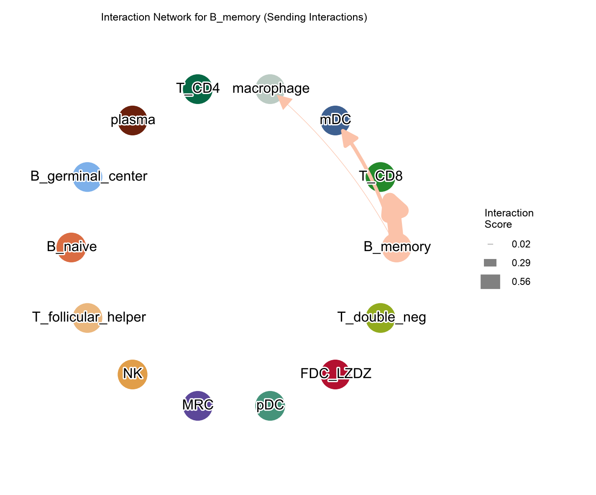

A quick way to choose: sum the scores of the rows you plot per edge
(`res.groupby(["sender", "receiver"]).interaction_score.sum()` on the
filtered rows) and take `edge_width_scale ~ 8 / max`, which puts the
heaviest edge at roughly 8 points - 11 here, taken from the second tier
so that both panels share it.

Which cell type to pick matters too. `B_germinal_center` has no calls
at either tier on this dataset, so its network is empty. If a network
looks sparse, check how many rows survive the filters before adjusting
the drawing.

### Cumulative network across all cell types

```python
for threshold in (0.05, 0.10):
    la.pl.plotCCCNetworkCumulative(res, data=adata, groupby="cell_type",
                                   threshold=threshold)
```

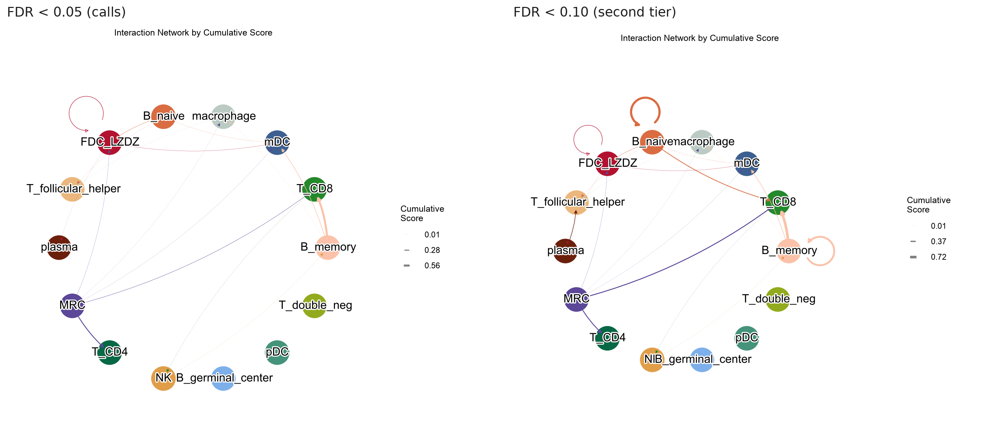

The loops are **self-interactions** - a cell type signalling to itself.
At FDR < 0.05 there is one, follicular dendritic cells (`NRG1::ITGB4`,
`LAMA3::ITGB4` and two glutamate-receptor calls). The second tier adds
memory B cells and naive B cells, the latter with the single strongest
interaction overall (`FCER2::CR2`, FDR 0.056). Autocrine and
within-cell-type signalling is common, so it is drawn like any other
edge, with the same colour-by-sender and width-by-score. Pass
`include_self_interactions=False` to either network function for a plot
restricted to interactions between different cell types.

## 5. The LR-score object is ordinary AnnData

`lr_data` has cells as rows and LR pairs as columns, so every scanpy
tool works on it directly. Copy across whatever annotations you want to
group by:

```python
lr_data.obs[["cell_type", "region_name"]] = adata.obs[["cell_type", "region_name"]].values
lr_data.obsm["X_spatial"] = adata.obsm["X_spatial"]
lr_data.obsm["X_umap"] = adata.obsm["X_umap"]

top = laris_lr.sort_values("score", ascending=False).index[:10]
sc.pl.dotplot(lr_data, top, groupby="cell_type",
              standard_scale="var", cmap="Spectral_r")
```

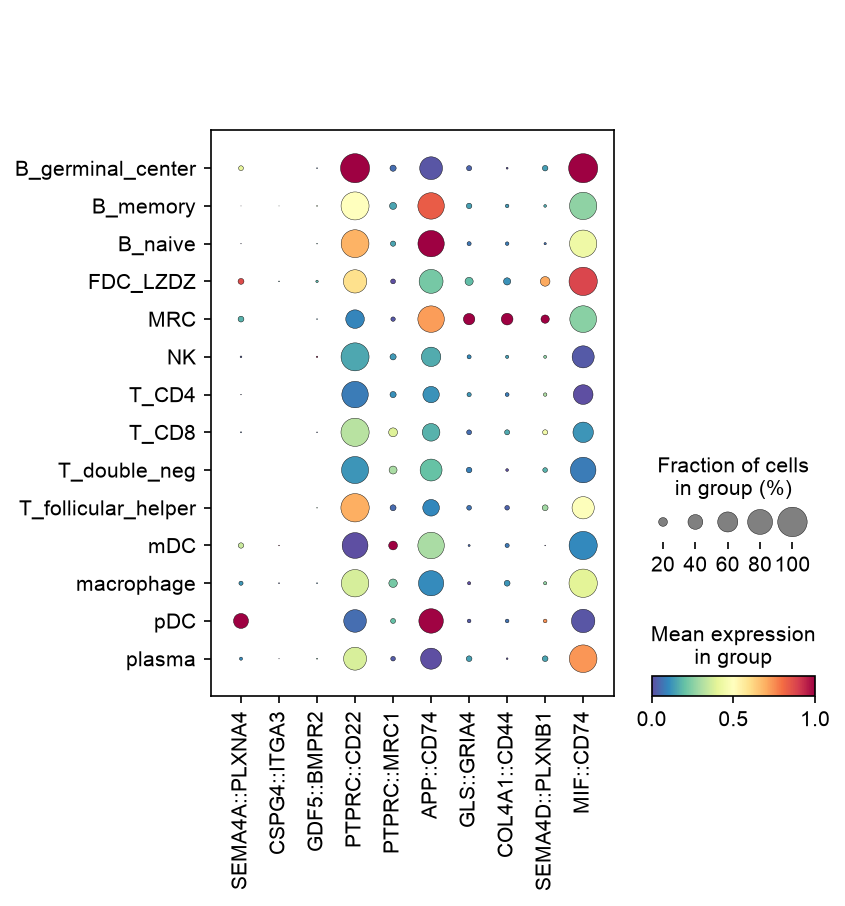

```python
sc.pl.dotplot(lr_data, top, groupby="region_name",
              standard_scale="var", cmap="Spectral_r")
```

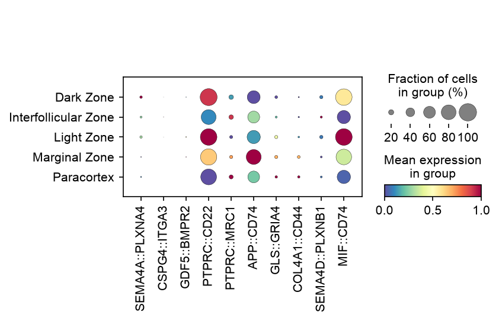

The same scores on the tissue and on the UMAP, several pairs at once
(`res` is ordered by p-value, so its first nine distinct names are the
nine most significant interactions):

```python
sc.pl.embedding(lr_data, basis="X_spatial", color=top[:4],
                cmap="magma_r", ncols=4, frameon=False)
```

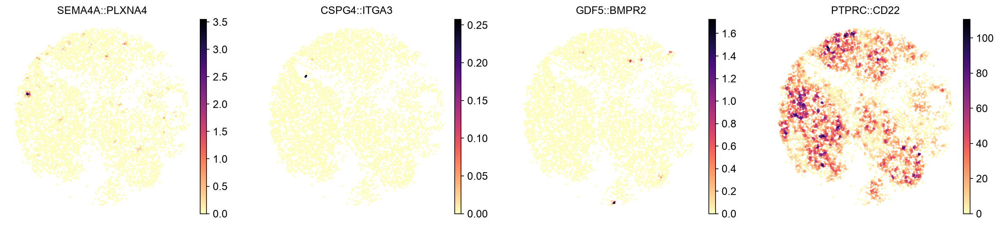

```python
sc.pl.embedding(lr_data, basis="X_umap",
                color=res["interaction_name"].unique()[:9],
                cmap="magma_r", ncols=3, frameon=False)
```

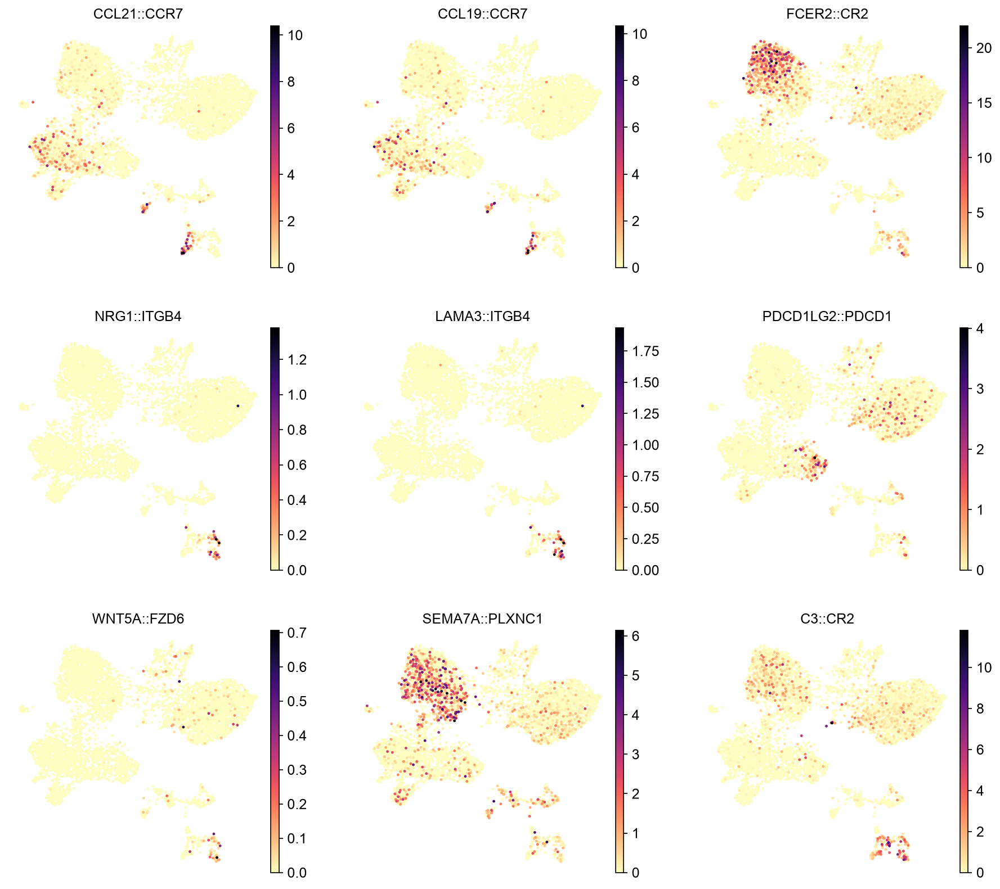

### Which interactions mark which region

Because `lr_data` is AnnData, COSG can find marker *interactions* for a
grouping exactly as it finds marker genes:

```python
import cosg
cosg.cosg(lr_data, key_added="cosg", mu=100, expressed_pct=0.15,
          remove_lowly_expressed=True, n_genes_user=100,
          groupby="region_name")

sc.pp.pca(lr_data, n_comps=30)
sc.tl.dendrogram(lr_data, groupby="region_name", use_rep="X_pca")
df = pd.DataFrame(lr_data.uns["cosg"]["names"][:6, ]).T
df = df.reindex(lr_data.uns["dendrogram_region_name"]["categories_ordered"])
markers = {idx: list(row.values) for idx, row in df.iterrows()}

sc.pl.dotplot(lr_data, markers, groupby="region_name", dendrogram=True,
              standard_scale="var", cmap="Spectral_r")
```

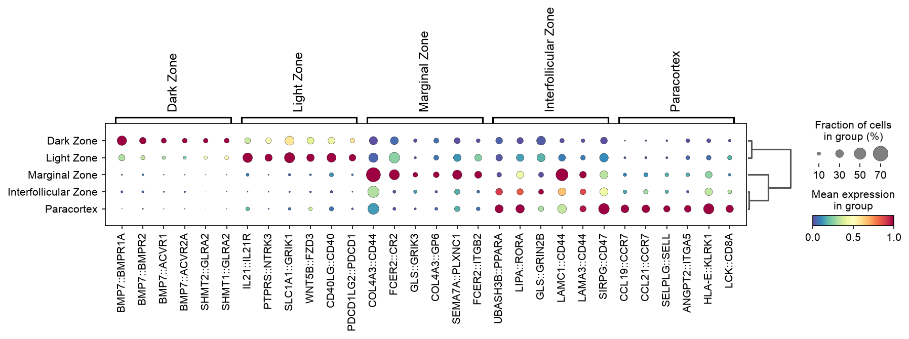

The result reads as tonsil anatomy without being told any of it: the
**Light Zone** is marked by `IL21::IL21R`, the follicular-helper-to-B
signal that defines it; the **Dark Zone** by BMP7 receptor axes; the
**Marginal Zone** by `COL4A3::CD44` and `FCER2::CR2`; the
**Paracortex**, the T zone, by `CCL19::CCR7` and `CCL21::CCR7`.

## 6. Filtering the summary views

The summary plots take the same filter arguments, so the same result
table can be shown loosely or strictly. With both filters off, `n_top`
takes the top interactions by score - here the 2,000 strongest, down to
a score of 0.0008, in 191 of the 196 sender-receiver pairs:

```python
la.pl.plotCCCHeatmap(res, cmap="plasma", filter_significant=False,
                     filter_by_interaction_score=False, n_top=2000)
```

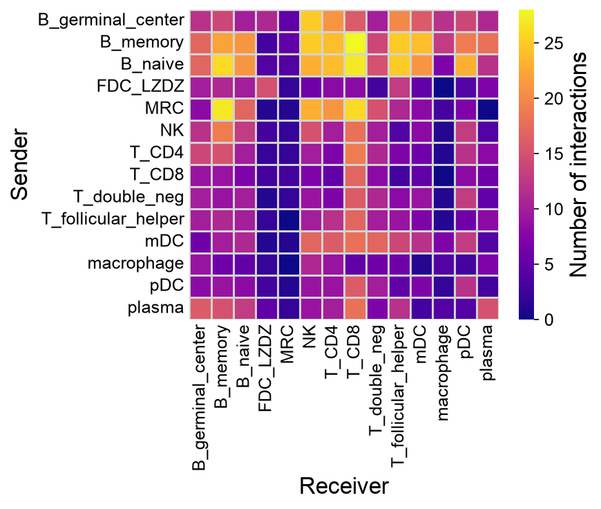

Filtered on FDR and score, the calls (27 rows in 17 pairs):

```python
la.pl.plotCCCHeatmap(
    res, cmap="Purples", figsize=(6, 5),
    axis_label_fontsize=16, tick_fontsize=12,
    cbar_label_fontsize=16, cbar_tick_fontsize=12,
    filter_significant=True, p_value_col="p_value_fdr", threshold=0.05,
    filter_by_interaction_score=True, threshold_interaction_score=0.01,
    show_borders=False, cluster=True)
```

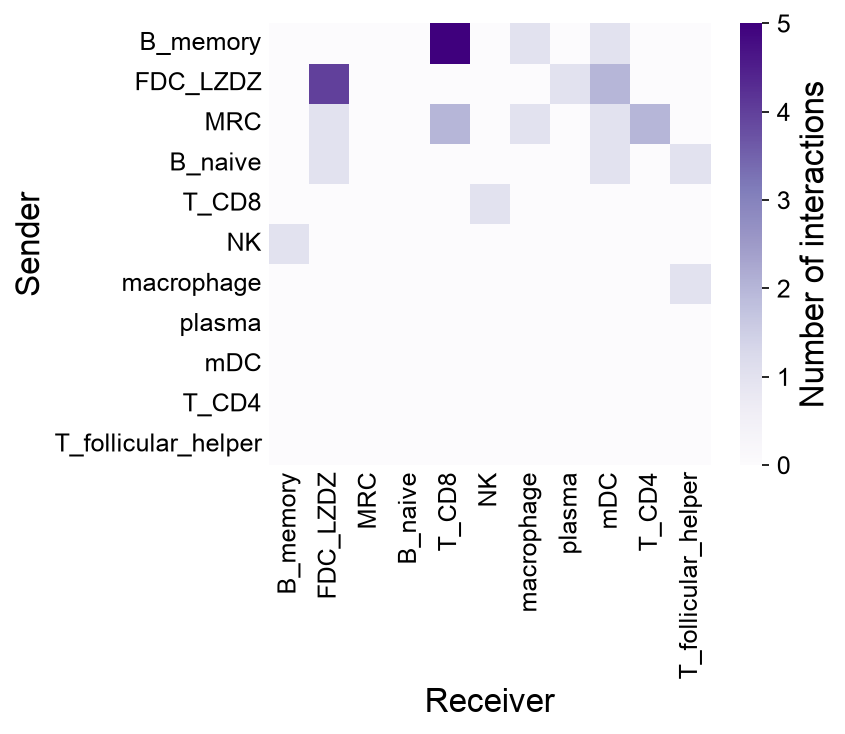

Relaxing the threshold to the second tier, `threshold=0.10`, admits 44
rows in 21 pairs:

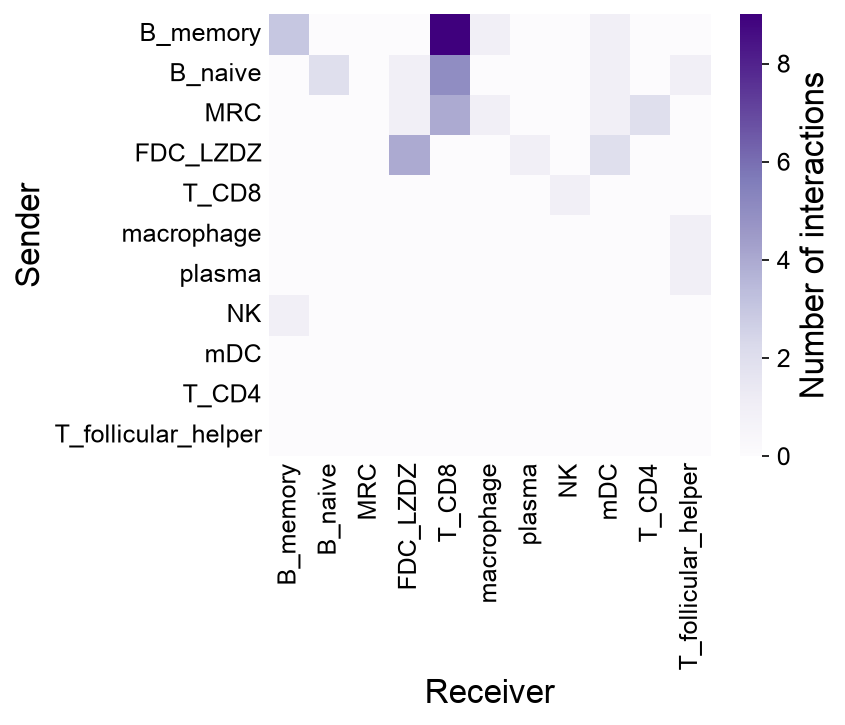

### A curated set of interactions

When you already know which interactions to show, pass them explicitly.
`senders` and `receivers` are paired element-wise into the columns, and
`interactions_to_plot` are the rows; every cell of that grid whose row
passes the filters gets a dot. Writing the three lists side by side, one
entry per interaction you have in mind, is the readable way to build
them (a repeated entry is drawn once):

```python
for threshold in (0.05, 0.10):
    la.pl.plotCCCDotPlot(
        res,
        interactions_to_plot=["CCL21::CCR7", "C3::CR2", "FCER2::CR2",
                              "PDCD1LG2::PDCD1", "TNFSF13B::TNFRSF13B",
                              "SEMA7A::PLXNC1", "FCER2::CR2", "COL4A3::CD44"],
        senders=["MRC", "MRC", "B_naive", "macrophage", "NK", "B_memory",
                 "B_naive", "B_memory"],
        receivers=["T_CD4", "FDC_LZDZ", "FDC_LZDZ", "T_follicular_helper",
                   "B_memory", "mDC", "B_naive", "B_memory"],
        bubble_size=500, cmap="YlGn",
        filter_significant=True, p_value_col="p_value_fdr", threshold=threshold,
        filter_by_interaction_score=True, threshold_interaction_score=0.01,
        figsize=(8, 6), show_grid=False, score_max=0.6)
```

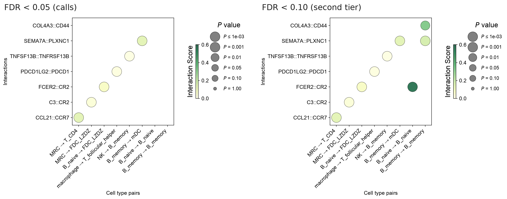

The first six are calls: T-zone homing (`CCL21::CCR7`), complement and
CD23 on follicular dendritic cells (`C3::CR2`, `FCER2::CR2`), the PD-1
checkpoint on follicular helper T cells, BAFF to TACI on memory B cells,
and semaphorin 7A to plexin C1 on dendritic cells. The last two appear
only at the second tier: `FCER2::CR2` among naive B cells, the
strongest score in the dataset (FDR 0.056), and `COL4A3::CD44` among
memory B cells (FDR 0.092); so does `SEMA7A::PLXNC1` among memory B
cells (FDR 0.078), a row-column combination the grid also covers. With
the default filters, an interaction that is not a call at the chosen
threshold simply has no dot.

`show_grid=True` adds guide lines, which helps when the panel is wide
(here at the second tier):

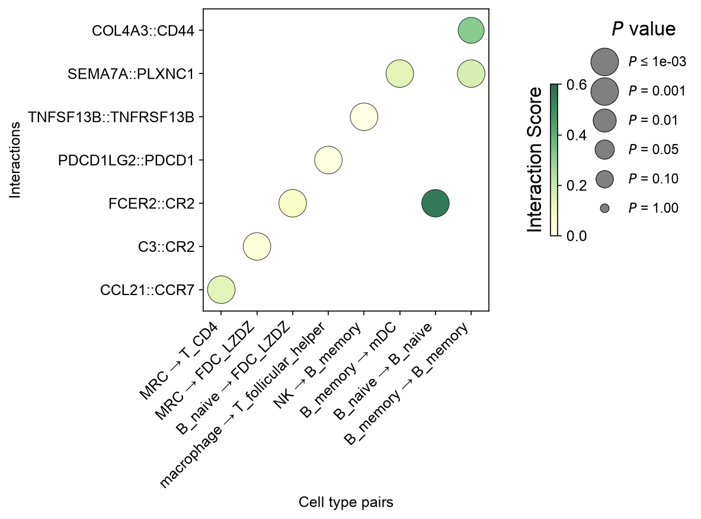

## Notes

- **Multi-section objects**: when several sections are tiled into one
  coordinate system, pass `section_key='<obs column>'` to both
  `prepareLRInteraction` and `runLARIS` — every spatial neighbour graph
  (including the randomised background) is then built within sections,
  so no neighbourhood crosses a tile boundary.
- **Targeted panels** (Xenium, MERFISH): few database genes are present,
  so the cell-type specificity spread over LR genes alone is unstable —
  use `runLARIS(..., specificity_reference='all')`. A warning fires
  automatically below 100 matched genes.
- **Reproducing v0.9.x**: pass `number_nearest_neighbors=10` to
  `prepareLRInteraction` and `mu=1, sigma=100, n_nearest_neighbors=10,
  number_nearest_neighbors=10, spatial_weight=1.0` to `runLARIS`.
- **Tissue image overlay** (H&E / ssDNA): see the
  [overlay tutorial](05_tissue_image_overlay.md).
- **Large data / on-disk workflows**: see the
  [cytome guide](04_cytome_guide.md).
- **Comparing conditions**: see the
  [aggregate](02_comparelaris_visium_mi.md) and
  [matched](03_comparelaris_matched_merfish_gut.md) comparison
  tutorials.
