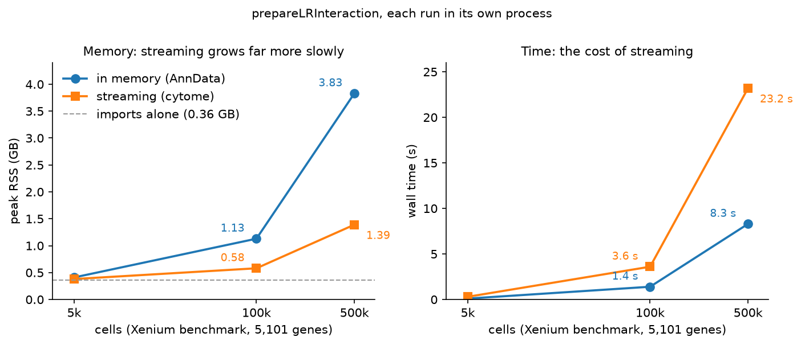

# Cytome usage guide: LARIS end to end on disk

LARIS accepts a [cytome](https://github.com/genecell/cytome) dataset — a
single-file, SQLite-backed format from the PIASO ecosystem — anywhere an
expression AnnData is expected, and for large data the whole pipeline can
stay on disk: scores are computed in blocks and written to an **LR
cytome** rather than materialised in memory. Install with
`pip install laris[cytome]`. All outputs below were produced by exactly
this code (tonsil data, LARIS v0.15.0).

## 1. Convert once

```python
import cytome
import laris as la

ds = cytome.from_anndata(adata, output="tonsil.cytome")
ds.close()
```

```text
tonsil.cytome: 60 MB on disk
```

## 2. Prepare LR scores — from the file, to a file

Give `prepareLRInteraction` the path. With a cytome input the return
follows the input (`return_type='auto'`): the scores are streamed to
disk as `tonsil.lr.cytome`, never fully in memory. Only the
ligand/receptor gene subset is ever read from the source file.

```python
lr_df = la.datasets.lrDatabase(species="human")
lr_path = la.tl.prepareLRInteraction("tonsil.cytome", lr_df)
lr_path
```

```text
'tonsil.lr.cytome'
```

The LR cytome reuses the registered RNA modality with the
ligand–receptor pairs as its feature table, and carries a single score
layer (there are no counts to store), so every cytome reader works on it
unchanged:

```python
ds = cytome.open(lr_path)
ds.list_matrices()
```

```text
['RNA_lrscore']
```

Options: `return_type='anndata'` to get an in-memory object from a
cytome source anyway; `output=` to choose the path; `overwrite=True` to
replace an existing file (never silent); `block_size=` to bound peak
memory for the AnnData path too.

## 3. Run LARIS from the files

The matched-gene background for the p-values (see
[tutorial 07](07_significance_and_background.md)) takes the path too. It
streams the per-gene statistics in one pass over the file and then loads
only the genes its tables need (the candidate pool and the LR genes):

```python
bg = la.tl.prepareLRBackground("tonsil.cytome", lr_df,
                               use_rep_spatial="X_spatial")
```

```text
  - cytome stats pass over 25,583 genes (sparse gene blocks, stored dtype)...
  - pool grown 4,000 -> 4,279 genes so every LR gene has matched peers above it
  - side repair: pool 4,279 -> 4,383 genes (k/2 detected peers on each side of every LR gene where the transcriptome has them)
  - candidate pool: 4,383 genes (quantile grid over mean/variance)
  - loading 5,145 table genes (pool + LR) from cytome...
  - diffusing 5,145 genes through the 20-NN kernel graph...
  - building spatial-specificity graph and Gram tables...
  - done: 5,145 genes, support per pair up to 40,000 (floor 2.50e-05); 6 LR gene(s) with a truncated matched set
```

Both arguments of `runLARIS` accept paths. Cell-type specificity is
computed by streaming the expression from disk in chunks
(`cosg.run_cosg_cytome`) — no cells × genes matrix is built:

```python
laris_lr, res = la.tl.runLARIS(
    lr_path, data="tonsil.cytome",
    use_rep="X_spatial", use_rep_spatial="X_spatial",
    groupby="cell_type", background=bg)
```

```text
389,060 sender-receiver-LR rows; 54 at FDR<0.05, 129 at FDR<0.10
```

`cosg_backend='memory'` forces the in-memory path; `'auto'` streams only
for cytome sources, so AnnData users see no change.

## 4. Read the LR scores back when needed

```python
lr_back = la.pp.readLRCytome(lr_path)
```

```text
readLRCytome -> AnnData (5695, 1985), obsm ['X_pca', 'pca', 'X_spatial', 'spatial', 'X_umap', 'umap']
```

Embeddings come back under both their scanpy (`X_spatial`) and short
(`spatial`) spellings; tissue images stored in the cytome (cytome ≥
0.2.6) arrive in `uns['spatial']`, so `plotCCCSpatial` overlays them with
no extra argument. The plotting functions also accept the LR cytome path
directly as `lr_data=`.

## 5. The guarantee

The cytome path is not an approximation. The LR scores are bit-identical
to the AnnData path's:

```python
lr_mem = la.tl.prepareLRInteraction(adata, lr_df)     # AnnData path
np.array_equal(lr_back.X.toarray(), lr_mem.X.toarray())
```

```text
bit-identical to the AnnData path: True
```

So is the background (its matched sets and tables), and so are the
results when the cell-type specificity is computed in memory:

```python
bg_mem = la.tl.prepareLRBackground(adata, lr_df, use_rep_spatial="X_spatial")
_, res_mem = la.tl.runLARIS(lr_mem, adata, use_rep="X_spatial",
                            use_rep_spatial="X_spatial", groupby="cell_type",
                            background=bg_mem)
_, res_cy = la.tl.runLARIS(lr_path, data="tonsil.cytome", use_rep="X_spatial",
                           use_rep_spatial="X_spatial", groupby="cell_type",
                           background=bg, cosg_backend="memory")
```

```text
interaction_score, p_value, p_value_fdr, null_support: bitwise equal (389,060 rows)
```

With the default `cosg_backend='auto'`, a cytome source streams the
specificity from disk (`cosg.run_cosg_cytome`), which accumulates in
float32. The scores then agree to float32 precision (here at most
1.6e-7, relative 2e-6), so an exact tail count can move by one step:
8 of 389,060 p-values differ by one step (2.5e-5). The FDR column and the calls,
at FDR < 0.05 and < 0.10, are identical.

## 6. What it costs, measured

Each path was run in its own process, so the peak memory is the process's
own, not whatever was already resident:

```python
# in memory
adata = sc.read_h5ad("adata.h5ad")
lr_data = la.tl.prepareLRInteraction(adata, lr_df, use_rep_spatial="spatial")

# streaming, never holding the full matrix
la.tl.prepareLRInteraction("adata.cytome", lr_df, use_rep_spatial="spatial",
                           return_type="cytome", output="adata_lr.cytome",
                           block_size=512)
```

On this 5,695-cell tonsil the two are equivalent:

```text
h5ad 240.6 MB -> cytome 60.4 MB (conversion 10.6 s)
in memory : 0.81 GB peak, 0.5 s
streaming : 0.81 GB peak, 1.0 s
```

Of the 0.81 GB, 0.36 GB is Python with scanpy and LARIS imported; the
matrix is small at this size, so use whichever path is convenient. The
difference appears as the data grow. On the Xenium data of the runtime
benchmark (subsets of 5,000 to 500,000 cells, 5,101 genes), measured the
same way:



| cells | in memory | streaming |
|---|---|---|
| 5,000 | 0.41 GB, 0.1 s | 0.38 GB, 0.3 s |
| 100,000 | 1.13 GB, 1.4 s | 0.58 GB, 3.6 s |
| 500,000 | 3.83 GB, 8.3 s | 1.39 GB, 23.2 s |

The in-memory path holds the expression matrix and all the scores; the
streaming path holds blocks of them, so its peak grows far more slowly -
2.8x lower at 500,000 cells - for about three times the time. That is
why the on-disk path matters at Visium HD, Stereo-seq and atlas scale,
and the file is also 4x smaller on disk.

## Notes

- `laris.pp.readCytome(path, genes=[...])` streams an arbitrary gene
  subset into an AnnData — useful outside the LR workflow too.
- Works across cytome generations: files written before and after the
  cytome 0.3.0 layer-naming change (`{modality}_counts` reserved for raw
  integer counts) both resolve automatically; pass `layer=` to override.
- On-disk mode matters most at Visium HD / Stereo-seq / atlas scale; on
  a 5,695-cell tonsil it is simply equivalent (section 6).
