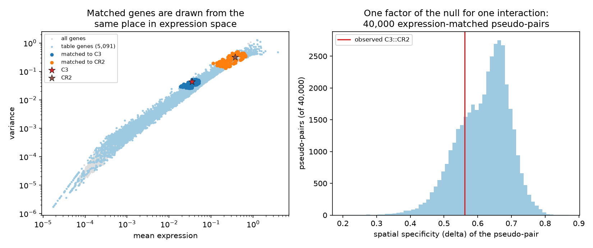
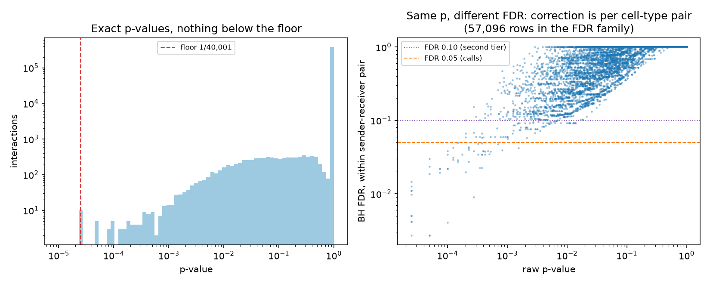
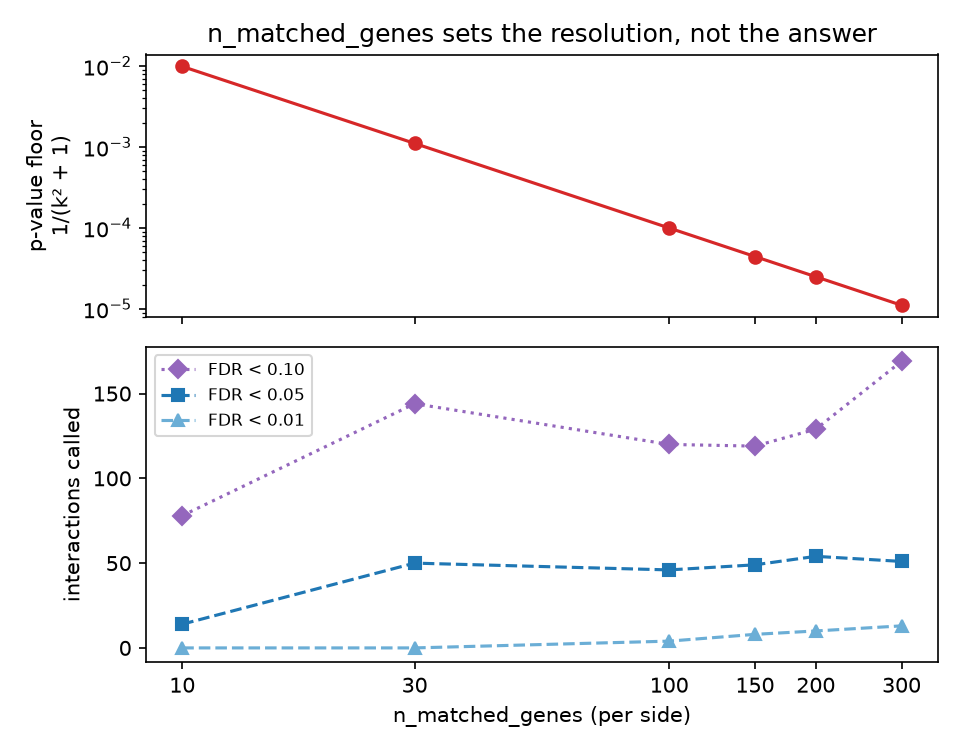

# Statistical significance: what the p-value tests, and how to get one

`runLARIS` ranks interactions by score whether or not you ask for
p-values. This tutorial is about the p-value: what question it answers,
how to compute one, and how to read the result honestly. All outputs
were produced by exactly this code with LARIS v0.15.0 on the Slide-tags
tonsil (Zenodo
[10.5281/zenodo.19981287](https://doi.org/10.5281/zenodo.19981287)).

## 1. The two-line version

```python
bg = la.tl.prepareLRBackground(adata, lr_df, use_rep_spatial="X_spatial")
laris_lr, res = la.tl.runLARIS(lr_data, adata,
                               use_rep="X_spatial",
                               use_rep_spatial="X_spatial",
                               groupby="cell_type",
                               background=bg)          # <- p-values
```

`prepareLRBackground` builds the reference the test compares against.
It is a separate step because it is the expensive part and it is
**reusable**: it depends only on the cells, the spatial graph and the
gene set, so one background serves every `groupby`, every parameter
sweep, and every re-run on the same object.

## 2. What the p-value actually tests

For each (sender, receiver, ligand::receptor) row the question is:

> Is this ligand-receptor pair more strongly and specifically
> co-organized between these two cell types than an
> **expression-matched pair of genes** would be?

The null is built by replacing the ligand with one of its
mean/variance-matched genes and the receptor with one of its own —
independently, so with 200 matched genes per side (the default for a
database of this size, see [§4](#4-choosing-n_matched_genes)) there are
**40,000 pseudo-pairs per real pair**. Each pseudo-pair is scored through the
*whole* pipeline (its own spatial specificity, its own detection
fractions, its own co-localization), and the p-value is the exact tail:

```
p = (# pseudo-pairs scoring at least as high + 1) / (# pseudo-pairs + 1)
```

Three consequences worth internalising:

- **It is exact and deterministic.** No sampling, no seed, no
  `n_permutations`. Re-running gives the same number.
- **The floor is 1/40,001 ≈ 2.5e-5** here. A p-value equal to the
  floor means "beat every pseudo-pair", not "p = 0".
- **This is not a test of "is there any signal".** It is competitive:
  against expression-matched chance. A highly expressed, broadly
  co-expressed pair can score high and still be unremarkable *for its
  expression level* — that is the intended behaviour.

So a **call**, a row with `p_value_fdr < 0.05`, is an interaction whose
score exceeds that of expression-matched gene pairs in the same
sender-receiver context, at an FDR of 5% within that context. Pairs of
the two cell types' *marker genes* are part of that null: if C3 marks
the sender and CR2 the receiver, other genes that mark the same two cell
types with the same expression level are in it too. A call therefore
certifies specificity beyond cell-type identity. What it cannot test is
whether the two proteins bind - that comes from the database
([§7](#7-what-the-database-contributes-measured)).

## 3. Running it, with real output

```python
import laris as la
import scanpy as sc

adata = sc.read_h5ad("adata_tonsil.h5ad")
lr_df = la.datasets.lrDatabase(species="human")
lr_df = lr_df[lr_df.ligand.isin(adata.var_names)
              & lr_df.receptor.isin(adata.var_names)]

lr_data = la.tl.prepareLRInteraction(adata, lr_df,
                                     use_rep_spatial="X_spatial")
bg = la.tl.prepareLRBackground(adata, lr_df, use_rep_spatial="X_spatial")
```

```text
  - pool grown 4,000 -> 4,279 genes so every LR gene has matched peers above it
  - side repair: pool 4,279 -> 4,383 genes (k/2 detected peers on each side of every LR gene where the transcriptome has them)
  - candidate pool: 4,383 genes (quantile grid over mean/variance)
  - diffusing 5,091 genes through the 20-NN kernel graph...
  - building spatial-specificity graph and Gram tables...
  - done: 5,091 genes, support per pair up to 40,000 (floor 2.50e-05); 6 LR gene(s) with a truncated matched set
```

The background took about 20 seconds on this 5,695-cell
dataset and is the one-time cost; keep it in memory (or `pickle` it) and
reuse. The pool lines are the matching at work: the candidate pool
is grown until every LR gene has 100 detected genes of lower and 100 of
higher mean expression wherever the transcriptome has them, so that its
matched set can straddle it. Six genes are at the very edge of the
transcriptome and get a smaller, still symmetric set
([§5](#5-reading-the-results-honestly)).



This is what "expression-matched" means, for one pair. C3 and CR2
(stars) each receive 200 partners drawn from the candidate pool at the
same place in mean/variance space - the tight clouds around each star,
half below and half above it. Every one of the 40,000 pseudo-pairs for
`C3::CR2` is one blue gene crossed with one orange gene, so the
comparison controls for expression level and variability instead of
pitting the pair against arbitrary genes.

The right panel shows *one factor* of that null, spatial specificity. On
it alone `C3::CR2` is unremarkable: 77% of its pseudo-pairs are
at least as spatially specific. Its p-value is nevertheless the floor,
2.5e-5, because the test scores the *whole* interaction - C3's
specificity to marginal reticular cells, CR2's to follicular dendritic
cells, their detection in both and the co-localization of the two cell
types, together with the spatial factor - and no pseudo-pair matches
all of them at once.

Two things follow, and both matter when reading a result. Because the
matching is per gene, a *highly expressed* ligand is judged against
other highly expressed genes, so being abundant earns no significance
by itself. And because the two sides are drawn independently, the null
keeps each gene's own behaviour while destroying the pairing - which is
exactly the alternative hypothesis being tested.

```python
laris_lr, res = la.tl.runLARIS(lr_data, adata,
                               use_rep="X_spatial",
                               use_rep_spatial="X_spatial",
                               groupby="cell_type", background=bg,
                               sort_by="p_value")

res.head(8)[["sender", "receiver", "interaction_name", "interaction_score",
             "p_value", "p_value_fdr", "ligand_rank", "receptor_rank"]]
```

```text
    sender            receiver interaction_name  interaction_score  p_value  p_value_fdr  ligand_rank  receptor_rank
       MRC               T_CD4      CCL21::CCR7           0.138081 0.000025     0.004162     0.005000       0.004975
       MRC               T_CD4      CCL19::CCR7           0.099058 0.000025     0.004162     0.004975       0.004975
   B_naive            FDC_LZDZ       FCER2::CR2           0.072694 0.000025     0.004950     0.004975       0.009950
  FDC_LZDZ            FDC_LZDZ      NRG1::ITGB4           0.054539 0.000025     0.011050     0.070000       0.004975
  FDC_LZDZ            FDC_LZDZ     LAMA3::ITGB4           0.027441 0.000025     0.011050     0.095000       0.004975
macrophage T_follicular_helper  PDCD1LG2::PDCD1           0.023128 0.000025     0.009825     0.009950       0.004975
  FDC_LZDZ              plasma      WNT5A::FZD6           0.012432 0.000025     0.014575     0.004975       0.004975
  B_memory                 mDC   SEMA7A::PLXNC1           0.137342 0.000025     0.005025     0.004975       0.004975
```

With `sort_by="p_value"` the results come **ordered by p-value, ties by
score**, so the head of the table is the strongest evidence; the
default, `sort_by="interaction_score"`, ranks by strength. 54
interactions pass FDR < 0.05 (49 distinct LR pairs), 129 the second tier
FDR < 0.10, and 10 FDR < 0.01. CCL19 and CCL21 from marginal reticular
cells to CCR7-expressing CD4 T cells is the chemokine axis that
positions T cells in the T zone. `C3::CR2` from marginal reticular cells
to follicular dendritic cells is the germinal-centre antigen-trapping
axis (FDR 0.013), and `PDCD1LG2::PDCD1` from macrophages to follicular
helper T cells is the PD-1 checkpoint (FDR 0.0098). None was supplied as
prior knowledge.

**`ligand_rank` and `receptor_rank` say which partner carries a call.**
`ligand_rank` is the observed pair's rank among the ligand's matched
genes, each paired with the *observed* receptor: (1 + number of those
pairs scoring at least as high) / (1 + number of valid pairs), so
1/201 ≈ 0.005 means the ligand beats all of its peers given its
partner. `receptor_rank` is the same from the receptor's side. They
are descriptive, with a resolution of 1/(k + 1), not tests. Of the
54 calls, 44 rank within the top 5% on both sides; 10
lean on one partner:

```text
  sender     receiver    interaction_name  p_value_fdr  ligand_rank  receptor_rank
FDC_LZDZ     FDC_LZDZ         NRG1::ITGB4       0.0110       0.0700         0.0050
FDC_LZDZ     FDC_LZDZ        LAMA3::ITGB4       0.0110       0.0950         0.0050
FDC_LZDZ T_double_neg        COL9A2::CD44       0.0428       0.0050         0.1194
      NK     B_memory TNFSF13B::TNFRSF13B       0.0289       0.0796         0.0050
FDC_LZDZ          mDC           FN1::CD44       0.0420       0.0050         0.0746
FDC_LZDZ     FDC_LZDZ        LAMB1::ITGB4       0.0398       0.0547         0.0050
```

`NRG1::ITGB4` within follicular dendritic cells is carried by ITGB4: 7%
of NRG1's peers, paired with ITGB4, score at least as high, while none of
ITGB4's peers does when paired with NRG1. The ranks make such a lean
visible without a second test.



**Left**: every p-value is an exact tail count, so the distribution
stops at the floor and nothing lies below it; the spike at 1 is the
interactions that score zero or whose null is too thin to test.
**Right**: the same raw p-value maps to different FDRs, because
Benjamini-Hochberg runs *within* each sender-receiver pair - a p-value at
the floor in a pair with few tested interactions clears a stricter
threshold than the same p-value in a crowded one.

## 4. Choosing `n_matched_genes`

This is the only parameter most users need to think about, and it sets
the resolution of the test:

| `n_matched_genes` | pseudo-pairs per real pair | p-value floor |
|---|---|---|
| 30 | 900 | 1.1e-3 |
| 100 | 10,000 | 1.0e-4 |
| 200 | 40,000 | 2.5e-5 |

**The default, `'auto'`, sizes it to your database.** Within a
sender-receiver pair of `m` tested interactions, Benjamini-Hochberg calls
a single strong interaction only if its p-value is at most `0.05 / m`, so
the floor must be below that: `k**2 >= 20 m`. `'auto'` takes
`k = ceil(sqrt(n_pairs / 0.05))`, clipped to 100-200 and to the candidate
pool: 200 for databases of 2,000 or more pairs (this one has 1,985;
sender-receiver pairs here test about 300 interactions each), 125 for a
777-pair database. At `k = 100` (floor 1.0e-4) a single perfect
interaction cannot be called in a sender-receiver pair that tests more
than 500 interactions.

The cost of a larger `k` is in the assembly, not the background build,
since the null of each row has `k**2` entries. Matching quality degrades
slowly in gene space (the 200th-nearest gene by mean/variance is still a
close match; the 200th-nearest *pair* would not be).



Measured on the tonsil data, with the default support floor of `2k`
non-zero pseudo-pairs (see [§5](#5-reading-the-results-honestly)), this is
what the parameter does and does not change:

| `n_matched_genes` | floor | FDR < 0.05 | FDR < 0.01 | FDR < 0.10 |
|---|---|---|---|---|
| 10 | 9.9e-3 | 14 | 0 | 78 |
| 30 | 1.1e-3 | 50 | 0 | 144 |
| 100 | 1.0e-4 | 46 | 4 | 120 |
| 150 | 4.4e-5 | 49 | 8 | 119 |
| **200 (`'auto'` here)** | **2.5e-5** | **54** | **10** | **129** |
| 300 | 1.1e-5 | 51 | 13 | 169 |

At `k = 10` the floor is 1/101, so **a single interaction can never be
called**: Benjamini-Hochberg would need its p-value to be at most
0.05/m. Calls appear only where a fifth or more of a sender-receiver
pair's tested interactions sit at the floor together (14 at FDR < 0.05
here) - arithmetic about ties, not resolution. The strict column shows
the resolution directly: FDR < 0.01 needs a floor well below 0.01/m, and
its calls rise with `k`, from 0 at `k = 30` to 10 at `k = 200` and 13 at
`k = 300`. The FDR < 0.05 column barely moves from `k = 30` on (46 to
54), and it is not monotone: each `k` is a different null (wider matched
sets, more non-zero pseudo-pairs, a different support floor and so a
different set of tested interactions), and the FDR guarantee holds at
every one of them. This knob sets the *resolution* of the p-value, and
it has to be reported.

`n_pool` (default 4,000) sets how many genes the matched sets are drawn
from. The Gram tables are quadratic in the pool, so this is the memory
and build-time dial; the default is a good balance and covers the
mean/variance space on a quantile grid.

### Cost at scale

The pool is *augmented* with every covered database gene and repaired
so that every LR gene has detected peers on both sides, so the table
dimension is roughly `n_pool` plus the number of LR genes present. That
is why an object with more genes costs more at the same `n_pool`, and why
halving `n_pool` helps so much - the tables are quadratic in it. Build
times measured here (20 threads):

| object | genes | `n_pool` | table genes | build (v0.15.0) |
|---|---|---|---|---|
| tonsil, 5,695 cells | 25,583 | 4,000 | 5,091 | 22 s |
| Visium HD, 68,616 bins | 19,059 | 2,000 | 3,552 | 115 s |
| Xenium, 100,000 cells | 5,101 | 4,000 | 4,293 | 169 s |
| Xenium, 500,000 cells | 5,101 | 4,000 | 4,303 | ~14 min |

The tables are built in one pass over the cells (about 1.7 ms per cell at
4,300 table genes), so the build grows linearly with the number of cells
and quadratically with the table genes.

One practical warning: on a machine under memory pressure from other
jobs, the same call can take several times longer while the CPU looks
idle. A tonsil background measured at 1,485 s on a loaded node and 203 s
on the same node once quiet. If a build seems inexplicably slow, check
the machine before the code.

## 5. Reading the results honestly

**Use the FDR column, not the raw p.** `p_value_fdr` is
Benjamini-Hochberg *within each sender-receiver pair*, because that is
the unit a result is reported in ("cell type A signals to cell type B
via L::R"). Different cell-type pairs have different specificity
profiles, so per-pair correction keeps each pair's threshold driven by
its own p-value distribution. The adjustment controls the FDR *within*
each sender-receiver pair, which is how a result is read; there is no
tissue-wide FDR column.

**Two tiers.** `p_value_fdr < 0.05` are the calls; `< 0.10` is a useful
second tier, as long as it is labelled as such. On this tonsil the
second tier adds 75 interactions; random gene pairs scored the
same way get 1 call at 0.05 and 2 at 0.10
([§6](#the-control-that-does-apply)).

**Which interactions enter the correction is decided by the null, never
by the result.** An interaction is tested, that is, enters its pair's
Benjamini-Hochberg adjustment, when at least
`2k` of its pseudo-pairs score above zero (`null_support >= 400` at
`k = 200`; `runLARIS(min_null_support='auto')`). Rows below that get
`p_value = 1` and `p_value_fdr = 1`. Two reasons:

- *The tested set must not be chosen by the observed score.* The p-value
  counts the pseudo-pairs that score zero too, so testing only
  interactions that scored above zero, as versions before 0.15.0 did,
  inflates the FDR: in a simulation where every interaction is null, a
  third to two thirds of the sender-receiver pairs then produce a false
  call. The support floor is a property of the null, fixed in advance,
  so it keeps the FDR valid.
- *Below `2k`, the test stops measuring strength.* The cell-type factors
  of the score are zero for genes detected in fewer than 10% of a group's
  cells, so in a sender-receiver pair where few matched genes pass that
  gate, the non-zero part of the null can come from a single matched
  gene's row or column of the `k x k` cross, and a tiny observed score
  beats an otherwise all-zero null. On this tonsil, without the floor
  (`min_null_support=0`), 95 interactions pass FDR < 0.05;
  63 of them come from rows with fewer than 400 non-zero
  pseudo-pairs (median 54), with a median score of
  0.0003 against 0.017 for the rest. Those are
  calls about clearing the detection gate, not about the interaction.

Here 57,096 of the 389,060 rows are tested; 70,582 rows have a thin null
(1 to 399 non-zero pseudo-pairs), only 404 of them with a positive
score. Pass `min_null_support=0` to test every row whose null is not
identically zero.

**The test is calibrated, and here is the check.** On data with no
structure to find - random counts, random coordinates, random labels -
the test returns essentially nothing: on this tonsil, with every gene's
counts permuted across cells, 1 of 389,060 interactions is called at FDR
< 0.05, and among the tested interactions 0.7% of p-values fall at or
below 0.05 (0.11% at or below 0.01): conservative. On data with a
planted spatially coherent interaction it recovers it with a small
p-value. Both are pinned in the test suite (`test_calibration_on_noise`,
`test_power_on_planted_signal`), and that pair is the calibration
control worth copying into your own. Note what is *not* on the list:
shuffling labels, shuffling coordinates, and scoring a rewired database
are none of them calibration checks -
[§6](#6-why-a-label-or-coordinate-shuffle-is-not-the-null) and
[§7](#7-what-the-database-contributes-measured) explain why.

**The floor and the FDR interact.** In a group of `m` tested
interactions where `k` reach the p-value floor, the smallest attainable
FDR is `(m/k) x floor`. The `'auto'` choice of `n_matched_genes` keeps
the isolated-hit bound below 0.05 for groups of up to about 2,000 tested
interactions, and LARIS warns when a group exceeds it.

**`p_value = 1.0` is meaningful**, not missing: it is what the test
returns when the interaction scores zero, when its null is too thin to
test (below the support floor), or when a gene has no matched set at all.

**`null_size` is the row's number of pseudo-pairs**, `k**2` minus the
database pairs that fall inside the cross, or fewer when a gene's
matched set is truncated (below). The row's p-value floor is
`1/(null_size + 1)`. Here it ranges from 1,600 to 40,000.

**Check `edge_limited`.** It flags an interaction with a gene whose
matched set is **truncated**: a gene so abundant (or so rare) that fewer
than `k/2` detected genes lie above (or below) it in the whole dataset.
Such a gene gets `t = min(k/2, genes below, genes above)` matched genes
on *each* side - a smaller set that still straddles it - and its rows
are tested like any other (`t = 0`, a gene detected in no cell, gives an
empty null and `p = 1`). On this whole transcriptome that is 6 of 962 LR
genes (HDC (8), PTPRC (20), CYP19A1 (40), CD74 (46), EREG (134), CXCL2
(142)), in 3,332 rows, none of them a call. On a targeted panel of a few
hundred genes it is common (57 of 399 LR genes on a 943-gene MERFISH
colon panel), and the truncation is what keeps those rows calibrated:
under a pure null 2.6% of their p-values fall at or below 0.05. Earlier
versions filled the short side from the other side instead, which biased
those nulls (2.9x nominal at 0.05 on a Visium HD pure null).

**Check `null_matchability`.** It reports how saturated a pair's matched
sets are: the fraction of matched genes whose expression lies below the
real gene's. 0.5 is healthy. Values near 1.0 mean every matched gene is
weaker, so every pseudo-pair is weaker than the real pair and the
p-value overstates. The pool repair above prevents it; on this dataset
every significant call has 0.5.

**Check `pair_breadth`.** The fraction of sender-receiver combinations in
which a pair is called. Genuine cell-type-specific results are narrow;
here the maximum is 0.01. A pair called across more than about a
quarter of the grid carries no cell-type information, however real its
expression.

**Check `null_support` before trusting a small p-value.** The null has
up to `n_matched_genes ** 2` entries, but many of them score exactly zero
because their matched genes are not co-detected in the two groups. A
zero can never exceed a positive observed score, so it enlarges the
denominator without adding resolution. `null_support` counts the
pseudo-pairs that scored above zero, and it is the null's *effective*
resolution: a row with `null_support = 400` reporting `p = 2.5e-5` is
resolving its score against those 400. That is why testing starts at
`2k`.

## 6. Why a label or coordinate shuffle is not the null

This is the most common way to mis-calibrate a LARIS run, so it is worth
being precise about.

Gene-set testing distinguishes two kinds of null hypothesis (Goeman &
Bühlmann 2007):

| | asks | calibrated by |
|---|---|---|
| **self-contained** | is this set associated with the phenotype at all? | **sample** permutation (shuffle labels) |
| **competitive** | is this set more associated than comparable genes? | **gene** permutation |

LARIS's p-value is **competitive**: the reference is 40,000
expression-matched pseudo-pairs. Its null is therefore generated by
permuting *gene identity*, and shuffling cell-type labels or spatial
coordinates is the calibration procedure for the other kind of test.
CellPhoneDB and CellChat shuffle labels precisely because their
statistics are self-contained; the two schemes are not interchangeable.

Concretely, if you shuffle labels, every group converges to the tissue
average, so the cell-type factors in the score converge to the same
constant for every gene — and a constant **cancels between the observed
score and its null**. What remains is a comparison of spatial
co-expression, which real database pairs win on merit because they are
genuinely co-expressed genes. Measured on the Slide-tags tonsil:

| tonsil | FDR < 0.05 | FDR < 0.01 | FDR < 0.10 |
|---|---|---|---|
| real labels | 54 | 10 | 129 |
| labels shuffled | 8 | 2 | 15 |
| coordinates shuffled | 48 | 6 | 240 |

The two controls behave very differently, and the difference is the
point. Shuffling **labels** destroys the cell-type structure the score
is built on, and the calls collapse - to 15% of the real-label count
here, and from 83 to 0 on a Visium HD mouse brain. Shuffling
**coordinates** barely moves the count at FDR < 0.05 (54 → 48) and
raises it at FDR < 0.10 (129 → 240): intermingling the cell types
removes the co-localization penalty that kept pairs of non-adjacent cell
types down, and the comparison itself survives - because the null is
rebuilt in the same shuffled world, so both the observed pair and its
40,000 pseudo-pairs lose their spatial structure together and the
comparison between them survives.

A coordinate shuffle is therefore not a failed sanity check; it is a
competitive test doing exactly what it says. Neither shuffle is this
test's null.

**Two things this means in practice.** Do not read a coordinate shuffle
as a failed sanity check. And do not compare *rescaled*
`interaction_score` values across runs **directly**: scores are rescaled
per run so the top-100 mean is 0.1, which makes the same numeric
threshold a different bar in each. Cross-run comparison is supported, it
just needs the factor divided out - every run records its own in
`celltype_results.attrs['laris_scale_factor']` (and
`lr_adata.uns['laris_scale_factor']`), so dividing each run's scores by
its factor puts them back on a common scale. Passing `rescale=False`
sets the factor to 1.0 and skips the step entirely.

### The control that does apply

If neither shuffle is the null, what is? A dataset with **no structure to
find**, and a gene set with **no pairing to find**:

- **Noise returns nothing.** A random count matrix with random
  coordinates and random labels yields **zero** interactions at
  FDR < 0.05 (`tests/test_factorized_null.py::test_calibration_on_noise`);
  the tonsil with every gene's counts permuted yields 1 call among
  389,060 interactions.
- **Planted signal is found.** A spatially coherent ligand blob in cell
  type A next to a receptor blob in B is recovered with a small p-value
  (`test_power_on_planted_signal`).
- **Random gene pairs are rarely called.** 2,000 random pairs of genes
  outside the database (detected in at least 20 cells), scored in the
  real tissue with the real labels and their own background, give 1
  call at FDR < 0.05 and 2 at FDR < 0.10, against 54 and 129
  for the database.

Those together are the calibration story: the test finds structure that
is there and none that is not. If you want a control in your own suite,
that set is the one to copy.

### What the decoy database is *not*

`permuteLRPairs` rewires the database so that only the *pairing* changes.
It is tempting to read that as a pass/fail control — every decoy pair is
"wrong", so surely a calibrated run should return almost none of them.

**It does not, and that is not a defect.** On the tonsil data a rewired
database gets 18 calls at FDR < 0.05 where the real one gets 54 (3
against 10 at FDR < 0.01). The reason is the subject of the next
section: the p-value tests how a pair's expression is *arranged*, and a
rewired pair of two genes with the same marker structure is arranged
just as well. The decoy is therefore a **measurement of what the
database contributes**, not a check that your run is calibrated — see
[§7](#7-what-the-database-contributes-measured), which is where it
belongs.

## 7. What the database contributes, measured

Everything above is about *arrangement*: whether a pair's expression is
laid out specifically between two cell types. None of it tests the
**pairing** — whether this ligand actually binds this receptor. That
comes from the database, not from your data, and it is worth knowing how
much of a result rests on it.

The measurement is the one proteomics uses for the same problem: score a
decoy database alongside the real one. `permuteLRPairs` rewires the
database by repeated double-edge swaps, so every gene appears in exactly
as many pairs as before and only the pairing changes.

```python
q, decoy_res = la.tl.computeDecoyFDR(
    adata, lr_df, res, background=bg,          # the SAME background
    prepare_kwargs={"use_rep_spatial": "X_spatial"},
    run_kwargs={"use_rep": "X_spatial", "use_rep_spatial": "X_spatial",
                "groupby": "cell_type"})
la.tl.decoyReport(res, decoy_res)
```

```text
==================================================================
TARGET-DECOY REPORT — what the database contributes
==================================================================
  The p-value tests how the pair's expression is ARRANGED with respect
  to the cell types. The PAIRING itself comes from the database, not
  from the data. A rewired database scored the same way shows how much
  of the result chance pairing alone reproduces here.

FDR < 0.05   real database      54 calls   |  rewired      18   |
estimated pairing-FDR 0.38 FDR < 0.01   real database      10 calls   |
rewired       3   |  estimated pairing-FDR 0.43

  Best attainable pairing-FDR on this dataset: 0.306
  Read as: of the calls at this threshold, roughly this fraction are
  matched by a database whose pairings are random. High values do not
  mean the interactions are absent - they mean the DATA cannot
  distinguish this pairing from a comparable one, so the evidence for
  the pairing rests on the database. See tutorial 07.
==================================================================
```

The estimated pairing-FDR is 0.38 at FDR < 0.05 and 0.43 at FDR < 0.01:
a database whose pairings are random reproduces about two in five of the
calls, and that is the honest number. It does **not** mean the
interactions are absent — `C3::CR2` between marginal reticular cells and
follicular dendritic cells is real germinal-centre biology. It means the
*data* cannot distinguish that pairing from a comparable one: C3 marks
MRC, CR2 marks FDC, those cell types are adjacent, and a rewired pair of
two genes with the same marker structure looks the same to any
expression-based method. The evidence for the pairing is the database;
the evidence for the arrangement is the p-value.

This limit is shared by every expression-based cell-cell communication
method. LARIS reports it rather than leaving it implicit. Practically:
use the p-value to rank and localise interactions *from your database*,
and cite the database for the interaction itself.

One reusable note: the decoy run needs no second background. The
rewiring preserves the exact gene multiset, so every matched set is
identical and one `prepareLRBackground` serves both runs.

## 8. Without a background

`runLARIS(..., calculate_pvalues=True)` without `background=` still
runs, using the older resampled-pair null. It is kept for one release
so existing scripts do not break, but its p-values have a coarse
support and should not be used for new work — see the v0.12.0 and
v0.13.0 release
notes.

If you only need a ranking, `calculate_pvalues=False` skips the whole
question and is much faster.

## Notes

- **Reuse**: `bg` is independent of `groupby`, `mu` and
  `spatial_weight`. Building it once and passing it to several
  `runLARIS` calls (different cell-type annotations, parameter sweeps)
  is the intended pattern.
- **Cytome**: `prepareLRBackground` accepts a `.cytome` path or open
  dataset, and streams the gene statistics rather than loading the full
  matrix ([tutorial 04](04_cytome_guide.md)).
- **Sections**: pass the same `section_key` you pass to
  `prepareLRInteraction`, so the background's graphs respect the same
  section boundaries.
- **Matching settings**: the background's spatial-specificity graph
  (`use_rep_gsp`, `n_nearest_neighbors_gsp`, `sigma_gsp`, `section_key`)
  must be the one `runLARIS` builds (`use_rep`, `n_nearest_neighbors`,
  `sigma`, `section_key`); `runLARIS` checks this and raises otherwise.
  It also scores every observed interaction through the background's
  tables and raises if that disagrees with its own score, which catches
  a background built from different data or diffusion settings.
- **Matching method**: `matching='balanced'` (the default) is the only
  method that straddles the gene; `matching='knn'` is deprecated, and a
  background built before v0.15.0 (without the edge repair) triggers a
  warning in `runLARIS` - rebuild it.
- **Speed**: wheels ship compiled Rust kernels used automatically. Set
  `LARIS_NO_RUST=1` to force the pure-NumPy path; it gives the same
  p-values and partner ranks except, rarely, one step of their lattice
  where two scores tie (its float32 sums run in a different order).
- **Reproducibility across machines**: results are bitwise reproducible
  on one platform. Across platforms (Linux x86 and macOS arm64) per-gene
  statistics can differ in the last bits, which can swap two nearly tied
  genes in a matched set and move a borderline call, as a change of `k`
  does.
