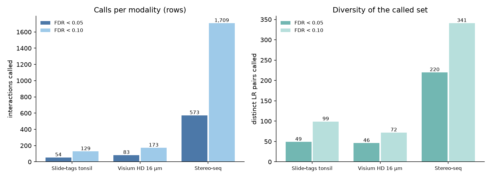
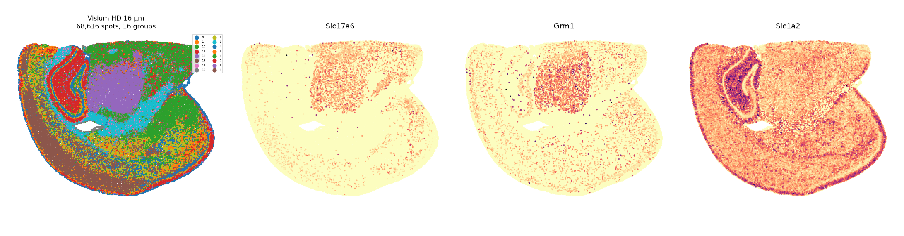
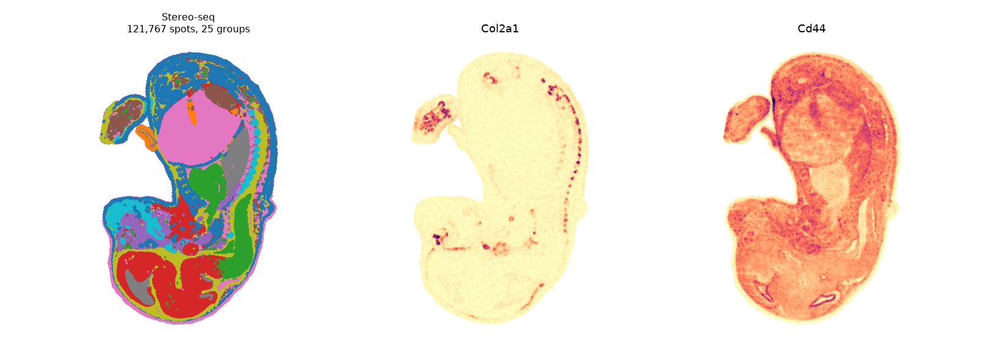

# LARIS across modalities: Slide-tags, Visium HD and Stereo-seq

One pipeline, three spatial technologies at very different resolutions
and scales. Every number and figure below was produced by the code
shown, with LARIS v0.15.0.

| | Slide-tags tonsil | Visium HD 16 µm | Stereo-seq |
|---|---|---|---|
| tissue | human tonsil | mouse brain | mouse embryo E16.5 |
| unit | single cell | 16 µm bin | cell bin |
| spots | 5,695 | 68,616 | 121,767 |
| genes | 25,583 | 19,059 | 28,204 |
| groups | 14 cell types | 16 clusters | 25 annotations |
| interactions, FDR < 0.05 | 54 | 83 | 573 |
| interactions, FDR < 0.10 | 129 | 173 | 1,709 |
| distinct LR pairs called (FDR < 0.05) | 49 | 46 | 220 |



The pipeline does not change between them. What changes is what a
"group" means — annotated cell types, unsupervised clusters of bins, or
anatomical annotations — and LARIS treats all three the same way: it
asks which ligand-receptor pairs are spatially co-organized *between*
groups, beyond expression-matched chance.

## 1. Visium HD (16 µm bins, mouse brain)

Bins are not cells: at 16 µm each bin mixes a small number of cells, so
groups here are spatial domains found by clustering rather than pure cell
types. That is a legitimate use of LARIS, with one caveat covered in
section 3.

```python
import laris as la
import scanpy as sc

adata = sc.read_h5ad("hd_16um.h5ad")          # bins x genes, X_spatial set
lr_df = la.datasets.lrDatabase(species="mouse")
lr_df = lr_df[lr_df.ligand.isin(adata.var_names)
              & lr_df.receptor.isin(adata.var_names)]

lr_data = la.tl.prepareLRInteraction(adata, lr_df, use_rep_spatial="X_spatial")
bg      = la.tl.prepareLRBackground(adata, lr_df, n_pool=2000,
                                    use_rep_spatial="X_spatial")
laris_lr, res = la.tl.runLARIS(lr_data, adata, use_rep="X_spatial",
                               use_rep_spatial="X_spatial",
                               groupby="cluster", background=bg)
res[res.p_value_fdr < 0.05].nlargest(3, "interaction_score")
```

```text
sender receiver interaction_name  interaction_score  p_value_fdr
     8        8    Slc17a6::Grm1            0.52277      0.01250
    13        8     Slc1a2::Grm1            0.33686      0.04008
    13        8  Slc6a11::Gabbr2            0.27927      0.01850
```



The top calls are glutamate and GABA axes converging on cluster 8, the
central domain of this section (the thalamus, by position and by
`Slc17a6`): `Slc17a6` (VGLUT2, the glutamate transporter of excitatory
neurons) to the metabotropic glutamate receptor `Grm1` within cluster 8,
`Slc1a2` (GLT-1, the astrocyte glutamate transporter) from cluster 13 to
the same receptor, and `Slc6a11` (GAT3, the astrocyte GABA transporter)
from cluster 13 to the GABA-B receptor `Gabbr2`. In this database, as in
CellChat's, a neurotransmitter is represented by the genes that make or
carry it. LARIS recovers neuron-astrocyte neurotransmitter axes in a
brain section without being told anything about brain biology, and it
separates the two directions: within cluster 8, and from cluster 13 to
cluster 8.

`n_pool=2000` is worth a word: the candidate pool sets the size of the
background's internal tables, which are quadratic in it. At 68,616 bins
the default 4,000 is affordable but slower; 2,000 halves the pool (the
LR genes and the pool repair add the rest, 3,552 table genes here).

## 2. Stereo-seq (cell bins, whole mouse embryo)

The largest object here, and the one where annotations are anatomical
rather than cell-type-level.

```python
adata = sc.read_h5ad("E16.5_E1S1.MOSTA.h5ad")
adata.X = adata.layers["count"].copy()
adata.obsm["X_spatial"] = adata.obsm["spatial"][:, :2].astype(float)

lr_df = la.datasets.lrDatabase(species="mouse")
lr_df = lr_df[lr_df.ligand.isin(adata.var_names)
              & lr_df.receptor.isin(adata.var_names)]

lr_data = la.tl.prepareLRInteraction(adata, lr_df, use_rep_spatial="X_spatial")
bg      = la.tl.prepareLRBackground(adata, lr_df, n_pool=2000,
                                    use_rep_spatial="X_spatial")
laris_lr, res = la.tl.runLARIS(lr_data, adata, use_rep="X_spatial",
                               use_rep_spatial="X_spatial",
                               groupby="annotation", background=bg)
res[res.p_value_fdr < 0.05].nlargest(3, "interaction_score")
```

```text
              sender receiver interaction_name  interaction_score  p_value_fdr
                Bone     Bone     Col2a1::Cd44            1.71104      0.04536
Cartilage primordium     Bone     Col2a1::Cd44            0.58853      0.01047
           Inner ear     Bone     Col9a2::Cd44            0.55322      0.02962
```



`Col2a1::Cd44` from cartilage primordium to bone is skeletal development
reading out of the data directly: type II collagen is the cartilage
matrix protein, and the interaction appears on the cartilage-to-bone
axis of an E16.5 embryo, with type IX collagen (`Col9a2`, another
cartilage collagen) from the inner ear to bone next to it.

## 3. Reading results from binned data

Two habits matter more at bin resolution than at single-cell resolution,
because a bin mixes cell types and mixed labels blur cell-type
specificity.

**Check `pair_breadth`.** It reports the fraction of sender-receiver
combinations in which a pair was called. Genuine cell-type-specific
results are narrow, while a pair called across a large fraction of the
grid is a tissue-ubiquitous one that carries no cell-type information,
however real its expression:

```python
res.loc[res.p_value_fdr < 0.05, ["interaction_name", "pair_breadth"]] \
   .drop_duplicates().nlargest(5, "pair_breadth")
```

On these objects the maxima are 0.016 (Visium HD) and 0.03
(Stereo-seq), so nothing is sweeping the grid. Anything above ~0.25
deserves a look before it goes in a figure.

**Check `edge_limited` on very abundant genes.** A gene so abundant that
fewer than 100 detected genes lie above it gets a smaller, symmetric
matched set ([tutorial 07](07_significance_and_background.md)). Binned
data concentrate expression in a few genes, so this happens more often
than on single cells: 21 LR genes on the Visium HD object (the most
abundant, such as `App`, `Apoe`, `Slc1a2` and `Thy1`, and nine genes
detected in no bin) against 6 on tonsil. Their rows are tested as usual,
with a smaller null (`null_size`) and so a coarser p-value floor.

**Expect far fewer calls if you are coming from an earlier version.**

| object | v0.13.0 | v0.15.0 |
|---|---|---|
| Slide-tags tonsil | 968 | 54 |
| Visium HD 16 µm | 683 | 83 |
| Stereo-seq (mouse embryo) | 7,251 | 573 |

Interactions at FDR < 0.05, both with a matched-gene background. This is
the FDR becoming valid, not a loss of signal. Up to v0.14.1
Benjamini-Hochberg covered the rows with a positive score, while each
p-value counts the pseudo-pairs that score zero; choosing the tested rows
by the observed score made the adjustment anti-conservative. v0.15.0
chooses them by the null alone, tests a row only when at least
`2k` of its pseudo-pairs score above zero, and repairs the matched sets
of the most and least abundant genes. The scores, and so every
score-based ranking and figure, are unchanged by this (except for LR
pairs expressed in fewer than `n_cells_expressed_threshold` cells; see
the v0.15.0 release notes).

**Check `null_matchability`.** Values near 1.0 mean the pair's matched
genes were all weaker than the real genes, so its p-value overstates.
LARIS warns when a significant call is affected; the pool repair in
`prepareLRBackground` normally prevents it.

## 4. Cost

Measured on the machine used for this tutorial (20 threads, nothing else
running):

| dataset | spots | `n_pool` | table genes | background build | `runLARIS` |
|---|---|---|---|---|---|
| Slide-tags tonsil | 5,695 | 4,000 | 5,091 | 22 s | 49 s |
| Visium HD 16 µm | 68,616 | 2,000 | 3,552 | 115 s | 84 s |
| Stereo-seq | 121,767 | 2,000 | 3,656 | 4 min | 4 min |

The background depends only on the cells, the spatial graph and the gene
set — not on `groupby` — so one build serves every annotation and every
parameter sweep on the same object. `pickle` it.

## Notes

- Both objects here were clustered rather than annotated by cell type
  (Visium HD) or carry anatomical annotations (Stereo-seq). LARIS does
  not require cell types specifically; it requires a grouping.
- Data: Visium HD mouse brain is the 10x public dataset; Stereo-seq is
  MOSTA E16.5_E1S1 (Chen et al. 2022).
- See [tutorial 07](07_significance_and_background.md) for what the
  p-value does and does not claim.
